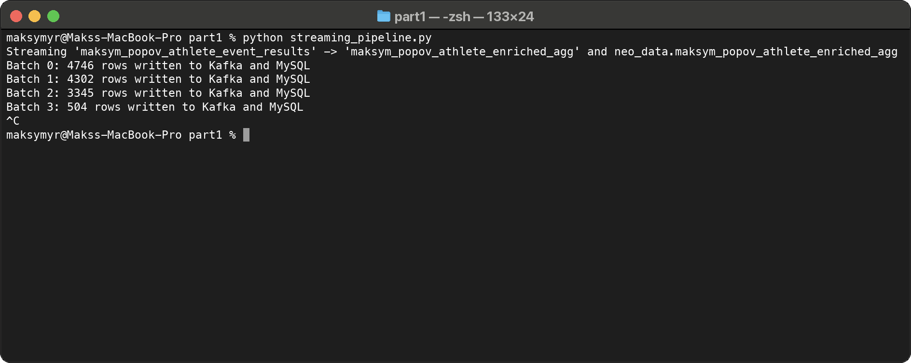
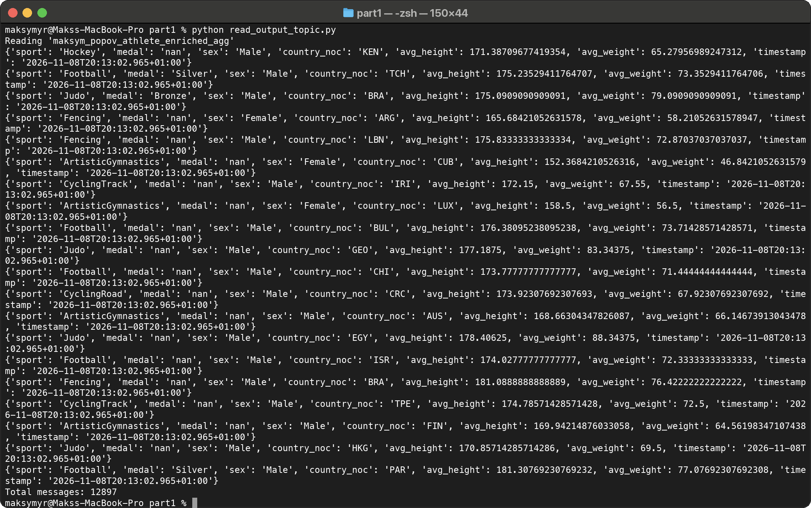
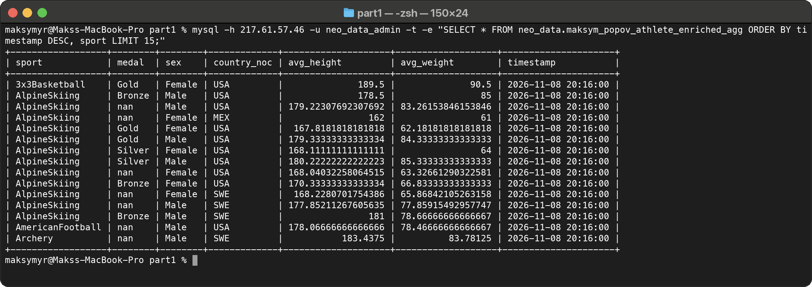
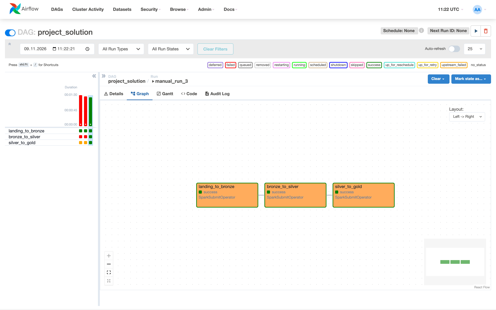
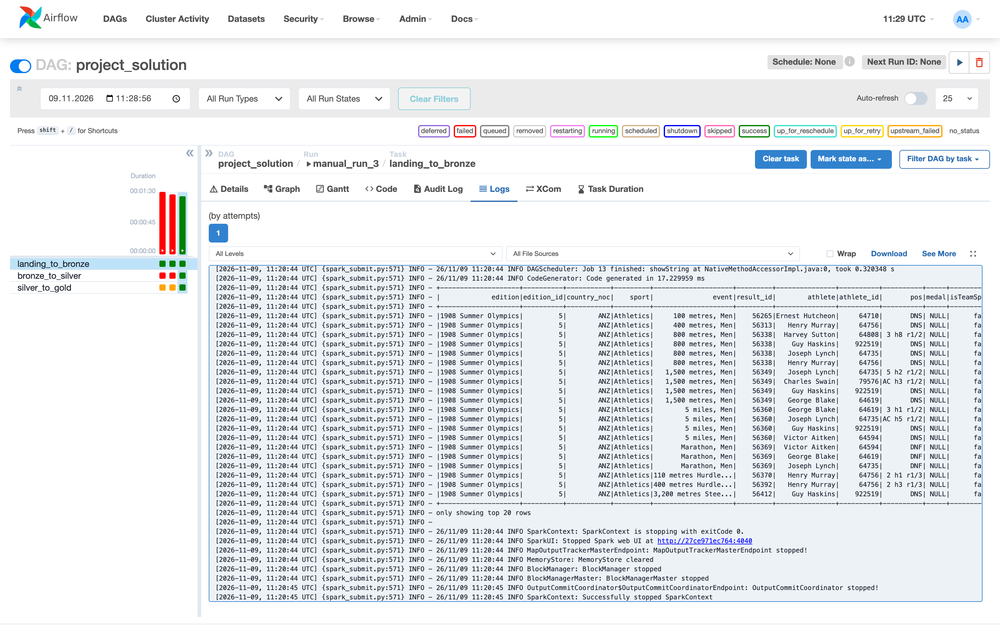
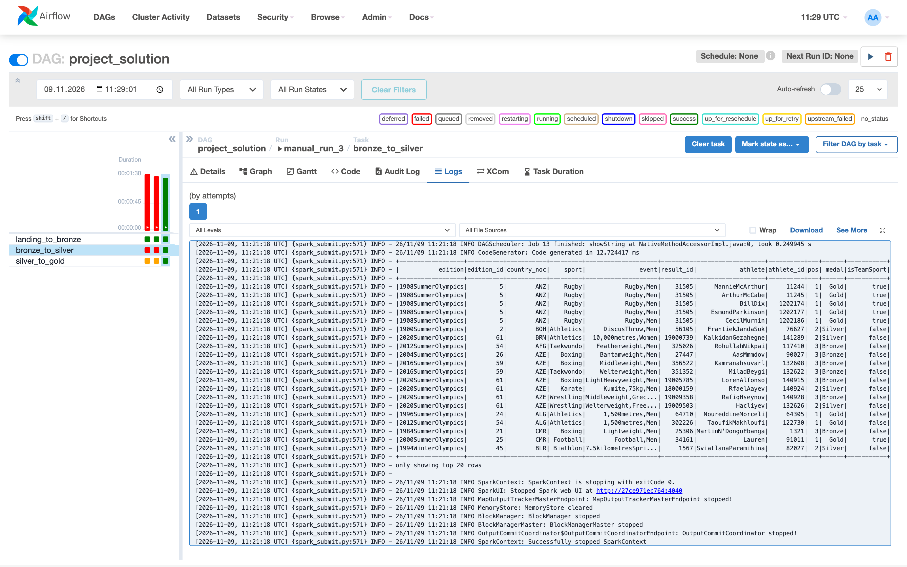
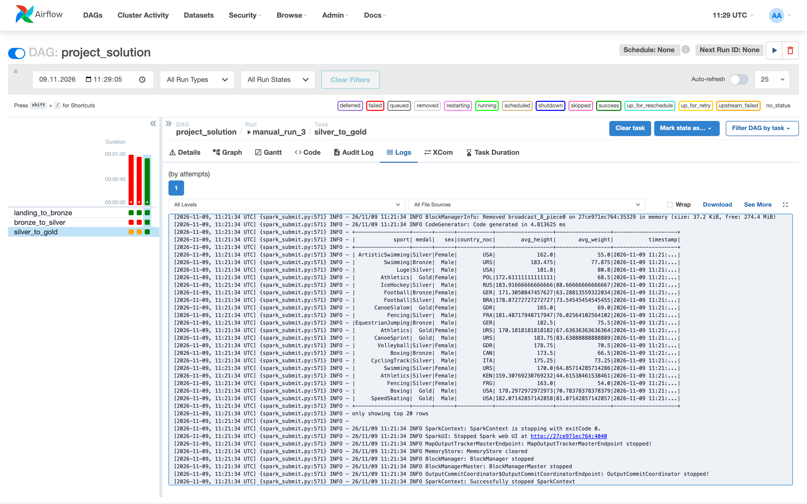

# Фінальний проєкт. Data Engineering

Студент: Максим Попов, CS & AI 2

## Частина 1. End-to-End Streaming Pipeline

Код у [part1/](part1/). Дані атлетів читаю з MySQL курсу, результати змагань проганяю через Kafka, рахую середні в Spark Streaming і через `foreachBatch` пишу результат у Kafka-топік і в MySQL. Етапи завдання позначені в коді коментарями `# Етап N`.

```bash
cd part1
pip install -r requirements.txt
cp configs.example.py configs.py   # дані для Kafka і MySQL
python create_topics.py
python mysql_to_kafka.py
python streaming_pipeline.py
python read_output_topic.py
```

Spark сам завантажує JDBC-драйвер MySQL і коннектор до Kafka.

### Етап 3. Результати змагань у Kafka

`mysql_to_kafka.py` читає `olympic_dataset.athlete_event_results` і пише рядки як JSON у топік `maksym_popov_athlete_event_results`.

### Стрімінг

`streaming_pipeline.py`:

1. читає `athlete_bio` з MySQL;
2. лишає атлетів, у яких зріст і вага є числами. У MySQL частина ваги записана діапазонами, які злиплися в одне число ("210-218" стало "210218"), тому вагу понад 300 кг теж відкидаю;
3. читає топік, розбирає JSON у колонки;
4. join з біо-даними по `athlete_id` (країну беру з `athlete_bio`, це країна походження атлета);
5. рахує середній зріст і вагу для кожної комбінації `sport`, `medal`, `sex`, `country_noc`;
6. у `foreachBatch` додає `timestamp` і пише батч у топік `maksym_popov_athlete_enriched_agg` і в таблицю `neo_data.maksym_popov_athlete_enriched_agg`.

Режим `update`, тому кожен батч пише тільки ті групи, середні яких змінились.



Вихідний Kafka-топік:



Таблиця в базі даних:



## Частина 2. Batch Data Lake

Код у [part2/](part2/). За погодженням з ментором DAG запускав локально: Airflow 2.9.3 у Docker, у який додав Java, PySpark і провайдер зі `SparkSubmitOperator`. Підключення `spark-default` створюється при старті контейнера, Spark працює в режимі `local`.

```bash
cd part2
docker compose up -d --build
```

UI на http://localhost:8080, логін `admin` / `admin`. DAG `project_solution` послідовно запускає три Spark jobs:

1. `landing_to_bronze.py` завантажує `athlete_bio` і `athlete_event_results` з FTP у `landing/` і зберігає їх як parquet у `bronze/{table}`;
2. `bronze_to_silver.py` чистить усі текстові колонки функцією `clean_text` (обгорнута в UDF), прибирає дублікати і пише в `silver/{table}`;
3. `silver_to_gold.py` робить join по `athlete_id`, рахує середні `weight` і `height` для кожної комбінації `sport`, `medal`, `sex`, `country_noc`, додає `timestamp` і пише в `gold/avg_stats`.

Вагу й зріст у gold приводжу до числа. Як і в частині 1, вагу понад 300 кг відкидаю: у CSV частина ваги записана діапазонами ("100-104"), а після `clean_text` вони злипаються в одне число.

Перші два запуски впали через нестачу пам'яті в Docker, після обмеження ресурсів Spark у DAG усе відпрацювало.



`landing_to_bronze`, вивід `df.show()` у лозі:



`bronze_to_silver`:



`silver_to_gold`:


