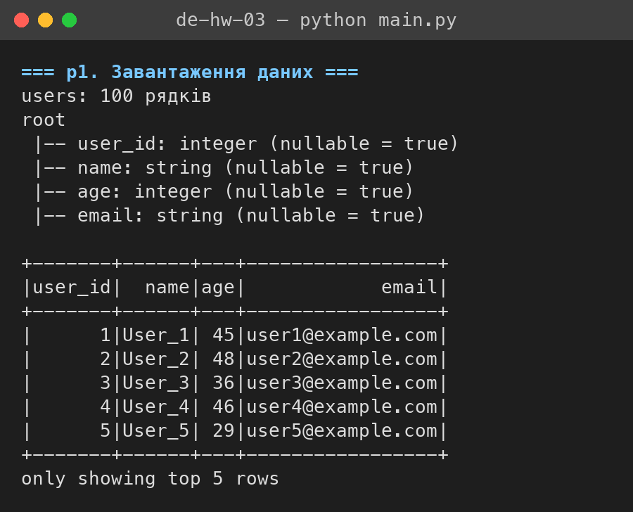
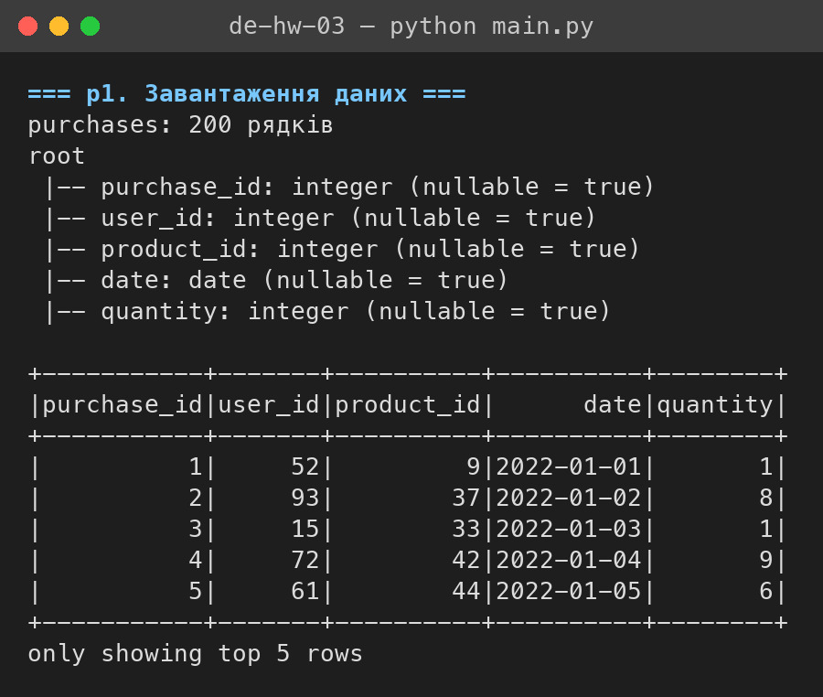
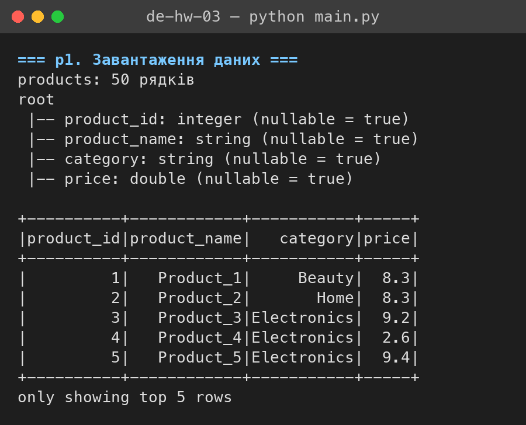
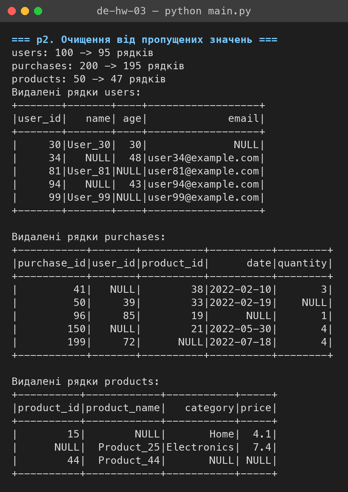
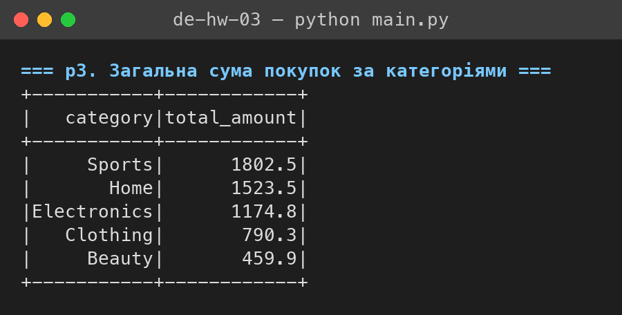
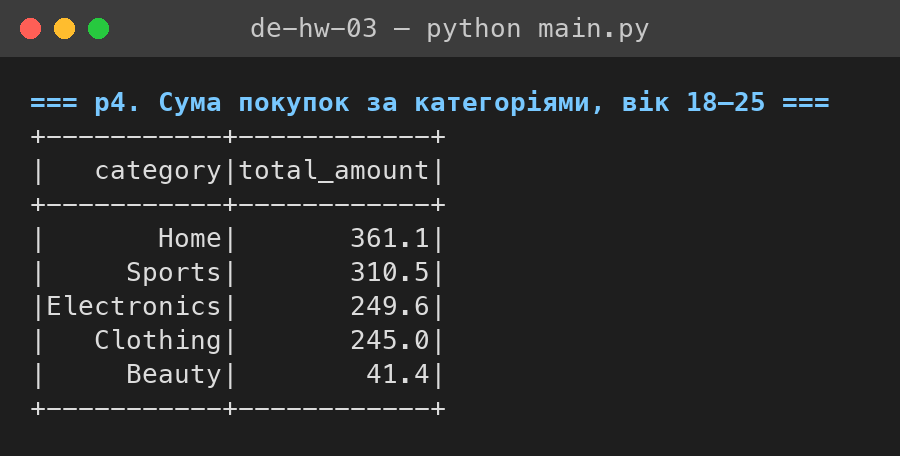
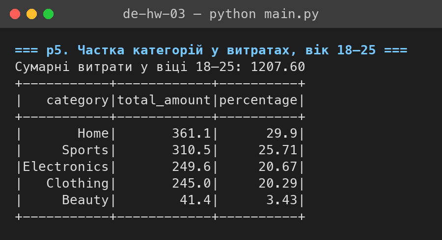
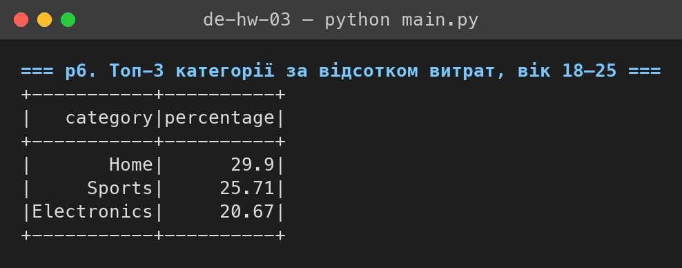

# Аналіз даних у PySpark

Домашнє завдання 3 курсу Data Engineering. Три CSV-файли — користувачі,
покупки й продукти — обробляються через Spark DataFrame API: очищення від
пропусків, з'єднання таблиць, агрегація витрат за категоріями товарів.

Увесь код — у файлі [main.py](main.py), вхідні дані — у теці [data/](data/),
скриншоти виводу `df.show()` — у теці [screenshots/](screenshots/).

## Запуск

```bash
pip install -r requirements.txt
python main.py
```

Потрібна Java 17+. Перевірено на PySpark 4.2.0 з Python 3.11 і 3.14, Java 21.

---

## 1. Завантаження даних

```python
def read_csv(spark: SparkSession, name: str) -> DataFrame:
    return spark.read.csv(str(DATA_DIR / f"{name}.csv"), header=True, inferSchema=True)

TABLES = ["users", "purchases", "products"]

raw = {name: read_csv(spark, name) for name in TABLES}
```

Кожен файл читається в окремий DataFrame. `inferSchema=True` одразу дає
правильні типи: ідентифікатори, вік і кількість — `integer`, ціна —
`double`, дата покупки — `date`.

| Таблиця     | Рядків |
|-------------|-------:|
| `users`     |    100 |
| `purchases` |    200 |
| `products`  |     50 |







---

## 2. Очищення від пропущених значень

```python
clean = {name: df.dropna() for name, df in raw.items()}
```

`dropna()` без аргументів видаляє рядок, якщо пропущене хоча б одне поле.

| Таблиця     | До  | Після | Видалено |
|-------------|----:|------:|---------:|
| `users`     | 100 |    95 |        5 |
| `purchases` | 200 |   195 |        5 |
| `products`  |  50 |    47 |        3 |

Для наочності скрипт виводить і самі видалені рядки — фільтр «хоча б одна
колонка `IS NULL`», зібраний через `reduce(or_, ...)` по всіх колонках.



---

## 3. Загальна сума покупок за категоріями

```python
purchases_amount_df = purchases_df \
    .join(products_df, "product_id", "inner") \
    .withColumn("purchase_amount", F.col("quantity") * F.col("price"))

purchases_amount_df \
    .groupBy("category") \
    .agg(F.round(F.sum("purchase_amount"), 2).alias("total_amount")) \
    .orderBy(F.col("total_amount").desc()) \
    .show()
```

Сума покупки — кількість одиниць, помножена на ціну одиниці товару. Для
цього запиту потрібні лише покупки й продукти: дані користувачів на суму за
категорією не впливають, тому таблиця `users` тут не приєднується.

| category    | total_amount |
|-------------|-------------:|
| Sports      |       1802.5 |
| Home        |       1523.5 |
| Electronics |       1174.8 |
| Clothing    |        790.3 |
| Beauty      |        459.9 |



---

## 4. Сума покупок за категоріями для віку 18–25

```python
AGE_FROM, AGE_TO = 18, 25

young_by_category_df = purchases_amount_df \
    .join(users_df, "user_id", "inner") \
    .where(F.col("age").between(AGE_FROM, AGE_TO)) \
    .groupBy("category") \
    .agg(F.sum("purchase_amount").alias("total_amount"))
```

`between` включає обидві межі, тобто відбираються покупці віком від 18 до 25
років включно. Суми округлюються до двох знаків лише під час виведення, а
`young_by_category_df` зберігає точні значення для наступних кроків.

| category    | total_amount |
|-------------|-------------:|
| Home        |        361.1 |
| Sports      |        310.5 |
| Electronics |        249.6 |
| Clothing    |        245.0 |
| Beauty      |         41.4 |



---

## 5. Частка категорій у витратах віку 18–25

```python
young_total = young_by_category_df.agg(F.sum("total_amount")).collect()[0][0]

young_share_df = young_by_category_df \
    .withColumn("percentage", F.round(F.col("total_amount") / F.lit(young_total) * 100, 2)) \
    .withColumn("total_amount", F.round("total_amount", 2)) \
    .orderBy(F.col("percentage").desc())
```

Спершу окремою агрегацією рахуються сумарні витрати групи — **1207.60**.
`collect()[0][0]` повертає це число в Python, і далі воно бере участь у
виразі як константа через `F.lit`. Частка подається у відсотках і
округлюється до другого знака після коми.

| category    | total_amount | percentage |
|-------------|-------------:|-----------:|
| Home        |        361.1 |      29.90 |
| Sports      |        310.5 |      25.71 |
| Electronics |        249.6 |      20.67 |
| Clothing    |        245.0 |      20.29 |
| Beauty      |         41.4 |       3.43 |

Сума відсотків — 100.00. У виводі Spark значення `29.9` показується без
кінцевого нуля, бо колонка має тип `double`.



---

## 6. Топ-3 категорії за відсотком витрат у віці 18–25

```python
young_share_df \
    .select("category", "percentage") \
    .limit(3) \
    .show()
```

`young_share_df` уже відсортований за спаданням відсотка, тому достатньо
взяти перші три рядки.

| category    | percentage |
|-------------|-----------:|
| Home        |      29.90 |
| Sports      |      25.71 |
| Electronics |      20.67 |

Разом ці три категорії дають понад три чверті витрат покупців віком 18–25.
Electronics і Clothing ідуть майже впритул — 20.67 % проти 20.29 %.


