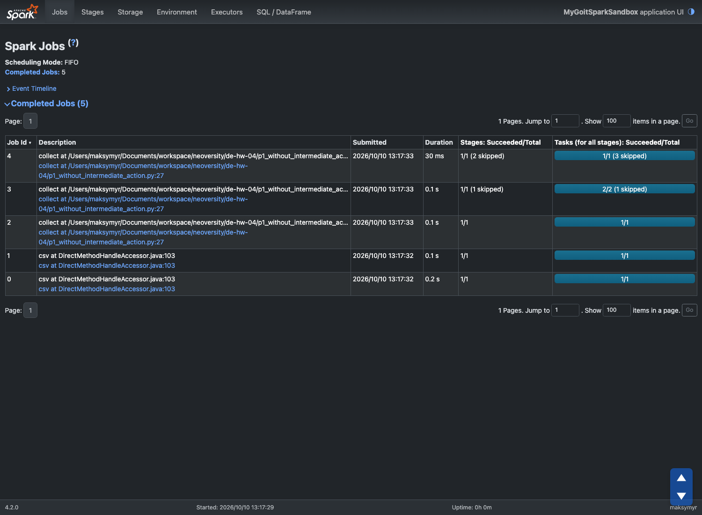
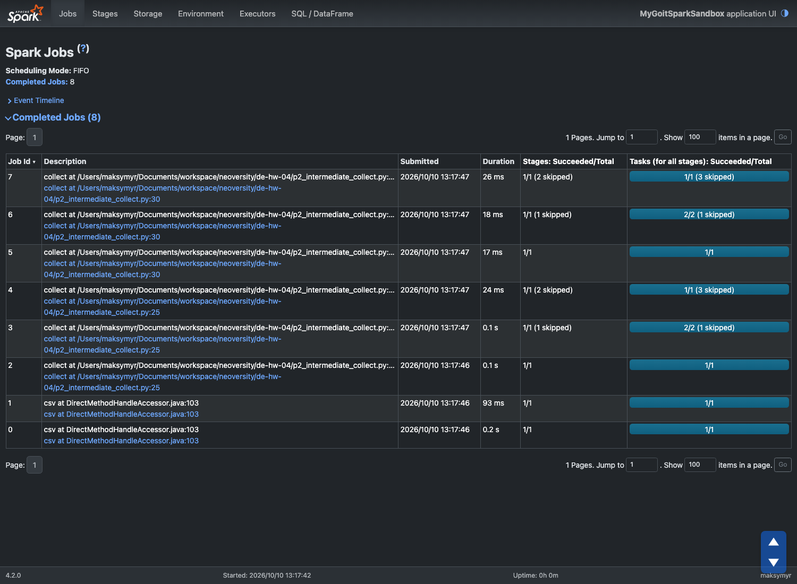
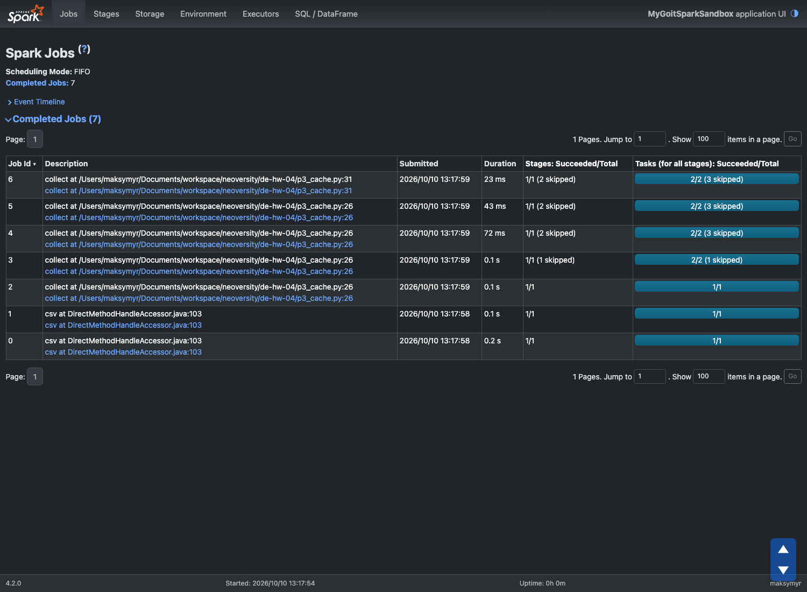
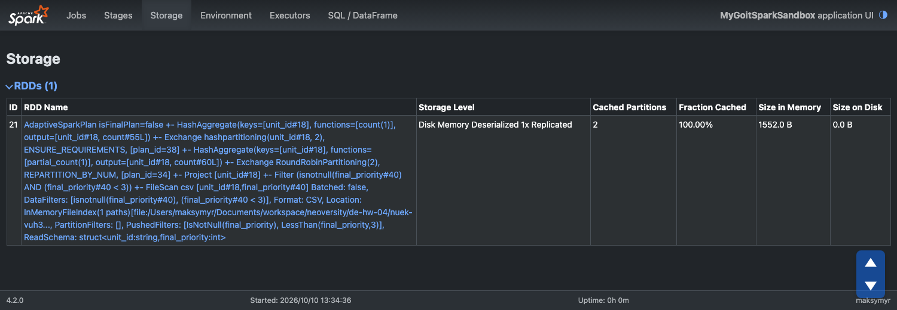

# Apache Spark. Оптимізація та SparkUI

Домашнє завдання 4 курсу Data Engineering. Три варіанти однієї програми
запущено локально, для кожного знято сторінку Jobs у SparkUI
(`http://localhost:4040/jobs/`) і пояснено, звідки береться саме така
кількість Jobs.

| Файл | Частина | Jobs |
|------|---------|-----:|
| [p1_without_intermediate_action.py](p1_without_intermediate_action.py) | 1. Один `collect()` | 5 |
| [p2_intermediate_collect.py](p2_intermediate_collect.py) | 2. Проміжний `collect()` | 8 |
| [p3_cache.py](p3_cache.py) | 3. Проміжний `collect()` + `cache()` | 7 |

Датасет — [nuek-vuh3.csv](nuek-vuh3.csv), 1000 викликів пожежної служби
Сан-Франциско. Середовище: Spark 4.2.0, Python 3.11, Java 21, режим
`local[*]`.

```bash
pip install -r requirements.txt
python p1_without_intermediate_action.py   # аналогічно p2_…, p3_…
```

Поки програма чекає на `input()`, SparkUI доступний за адресою
`http://localhost:4040/jobs/`.

---

## Звідки беруться Jobs

Перш ніж розбирати кожну частину — три механізми, з яких складається
результат.

**Читання CSV — 2 Jobs, хоча дії ще немає.** Щоб визначити схему, Spark
спершу читає перший рядок файлу — так він дізнається кількість колонок, а з
`header=true` ще й їхні назви (Job 0). `option("inferSchema", "true")`
змушує його пройти весь файл, щоб визначити типи колонок (Job 1). Обидві Jobs мають опис `csv at …` і з'являються в усіх
трьох програмах однаково.

**План обробки містить два shuffle.** `repartition(2)` перерозподіляє дані
на дві партиції, а `groupBy("unit_id")` збирає рядки з однаковим `unit_id`
в одну партицію. Кожен shuffle — це межа між Stages, тож план має три
Stages: читання й `repartition` → часткова агрегація → фінальна агрегація
й фільтр `count > 2`.

**Adaptive Query Execution запускає кожну Stage окремою Job.** У Spark 3.2+
AQE увімкнений за замовчуванням. Він виконує план по одній shuffle-Stage,
дивиться на фактичні розміри даних і лише тоді планує наступну. Тому одна
дія `collect()` дає не одну, а **три** Jobs. У кожній наступній Job уже
виконані Stages позначено як *skipped* — Spark бере їх результат із
shuffle-файлів, а не рахує знову.

Щоб переконатися, що розбиття дає саме AQE, ті самі три програми було
запущено ще раз із `--conf spark.sql.adaptive.enabled=false`. Результат —
3, 4 і 4 Jobs: дві на читання CSV і рівно одна на кожен `collect()`.

---

## Частина 1. Один `collect()` — 5 Jobs

```python
nuek_processed = nuek_repart \
    .where("final_priority < 3") \
    .select("unit_id", "final_priority") \
    .groupBy("unit_id") \
    .count()

nuek_processed = nuek_processed.where("count>2")

nuek_processed.collect()
```



| Job | Звідки | Що виконується |
|----:|--------|----------------|
| 0 | `csv` | читання заголовка |
| 1 | `csv` | визначення типів колонок (`inferSchema`) |
| 2 | `collect`, рядок 27 | читання файлу й shuffle для `repartition(2)` |
| 3 | `collect`, рядок 27 | часткова агрегація `groupBy` і shuffle за `unit_id` (1 Stage skipped) |
| 4 | `collect`, рядок 27 | фінальна агрегація, фільтр `count > 2`, повернення результату (2 Stages skipped) |

**2 + 3 = 5 Jobs.** Новий рядок `where("count>2")` — трансформація, тож
окремої Job він не додає: фільтр виконується в тій самій останній Stage,
що й фінальна агрегація.

---

## Частина 2. Проміжний `collect()` — 8 Jobs

```python
nuek_processed = nuek_repart \
    .where("final_priority < 3") \
    .select("unit_id", "final_priority") \
    .groupBy("unit_id") \
    .count()

nuek_processed.collect()                            # дія 1

nuek_processed = nuek_processed.where("count>2")

nuek_processed.collect()                            # дія 2
```



| Job | Звідки | Що виконується |
|----:|--------|----------------|
| 0–1 | `csv` | заголовок і `inferSchema` |
| 2–4 | `collect`, рядок 25 | `repartition` → часткова агрегація → фінальна агрегація (у Jobs 3 і 4 — 1 і 2 Stages skipped) |
| 5–7 | `collect`, рядок 30 | те саме ще раз, плюс фільтр `count > 2` (у Jobs 6 і 7 — 1 і 2 Stages skipped) |

**2 + 3 + 3 = 8 Jobs.**

**Чому одна проміжна дія дала одразу 3 Jobs.** Кожна дія над DataFrame —
це окремий запит, і Spark виконує його план від початку: знову читає CSV,
знову робить `repartition`, знову агрегує. Результат першого `collect()`
повернувся в Python як список і більше ніде в Spark не зберігся, тож
другому запиту нема чого перевикористати. А оскільки план має три Stages,
AQE знову розгортає його в три Jobs.

Це видно й на скриншоті: Job 5 не має skipped Stages, тобто читання файлу
і `repartition` виконано вдруге, а не взято з першого запуску.

---

## Частина 3. `cache()` — 7 Jobs

```python
nuek_processed_cached = nuek_repart \
    .where("final_priority < 3") \
    .select("unit_id", "final_priority") \
    .groupBy("unit_id") \
    .count() \
    .cache()

nuek_processed_cached.collect()                     # дія 1

nuek_processed = nuek_processed_cached.where("count>2")

nuek_processed.collect()                            # дія 2
```



| Job | Звідки | Що виконується |
|----:|--------|----------------|
| 0–1 | `csv` | заголовок і `inferSchema` |
| 2–3 | `collect`, рядок 26 | `repartition` → часткова агрегація, як і раніше |
| 4 | `collect`, рядок 26 | фінальна агрегація й **запис результату в кеш** (2 Stages skipped) |
| 5 | `collect`, рядок 26 | читання щойно закешованих даних і повернення результату (2 Stages skipped) |
| 6 | `collect`, рядок 31 | читання з кешу й фільтр `count > 2` (2 Stages skipped) |

**2 + 4 + 1 = 7 Jobs.**

`cache()` — це трансформація: сам виклик нічого не обчислює, а лише
позначає DataFrame як такий, що його треба зберегти в пам'яті. Дані
потрапляють у кеш під час першої дії.

**Перша дія стала на одну Job дорожчою.** AQE оформлює закешовану таблицю
окремим етапом запиту: спершу вона обчислюється й записується в пам'ять
(Job 4), а потім уже читається для `collect()` (Job 5). Тому перший
`collect()` дає 4 Jobs замість 3.

**Друга дія коштує лише одну Job.** Запит `nuek_processed_cached.where(…)`
починається вже не з CSV-файлу, а з закешованого результату агрегації. Йому
не потрібні ні читання файлу, ні обидва shuffle — виконується лише одна
Stage, що читає дані з пам'яті й застосовує фільтр. Дві Stages, з яких
колись були отримані закешовані дані, в цій Job позначено як skipped. У
частині 2 той самий запит коштував 3 Jobs.

Разом: −2 Jobs на другій дії, +1 Job, яку AQE додає на побудову кешу, — 7
замість 8.

### Навіщо потрібен `cache()`

Без кешу кожна дія заново проходить весь ланцюжок трансформацій від
джерела. Коли той самий проміжний результат використовується кілька разів
— кілька звітів з однієї агрегації, ітерації алгоритму, перевірка й запис
— `cache()` дозволяє порахувати його один раз і далі читати з пам'яті.
Ціна — оперативна пам'ять executors (а з AQE — ще й окрема Job на
заповнення кешу), тож кешувати варто лише те, що справді
перевикористовується.

Для DataFrame `cache()` використовує рівень `MEMORY_AND_DISK_DESER`:
дані зберігаються в пам'яті, а те, що не вмістилося, — на диску. Це видно
на вкладці Storage під час виконання частини 3 — рівень зберігання
«Disk Memory Deserialized 1x Replicated», обидві партиції в пам'яті:



Рівень `MEMORY_ONLY` — це значення за замовчуванням для `RDD.cache()`.
Інший рівень можна задати явно через `persist(StorageLevel...)`.

Після використання кеш звільняють через `unpersist()` — так і зроблено в
кінці програми.
