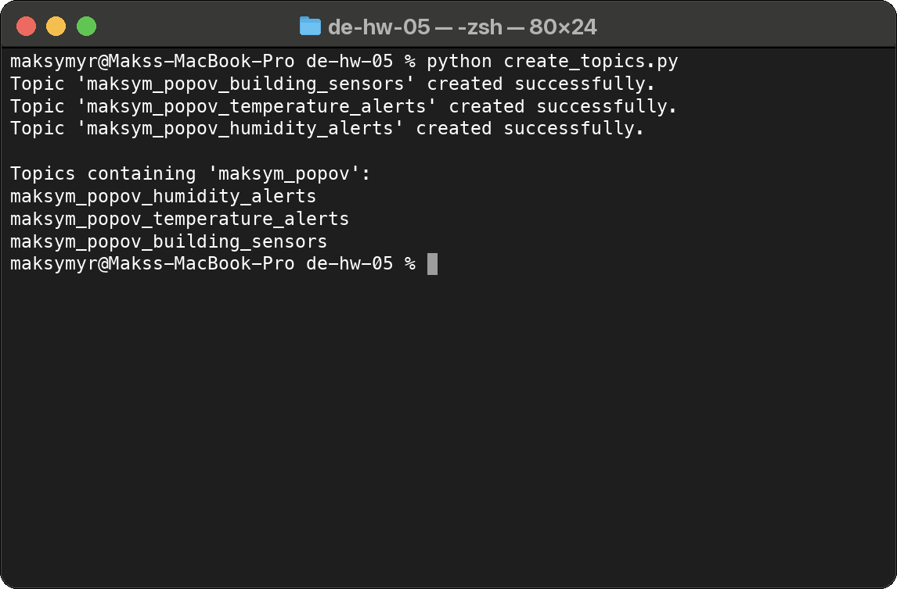
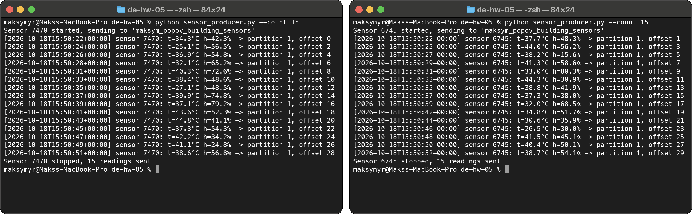
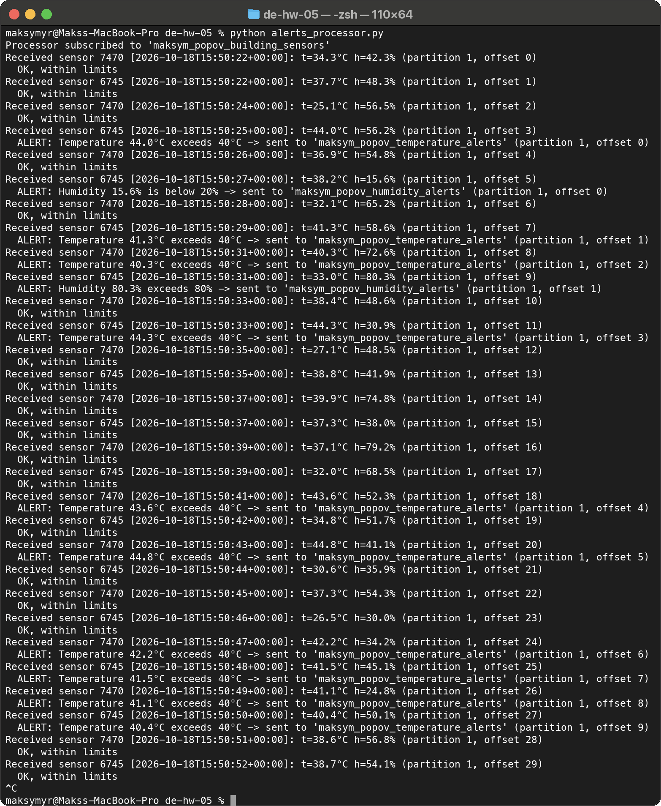
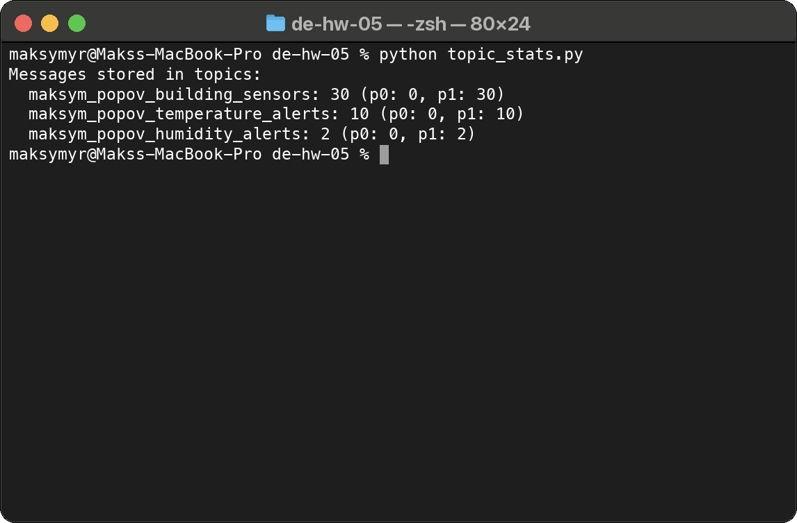
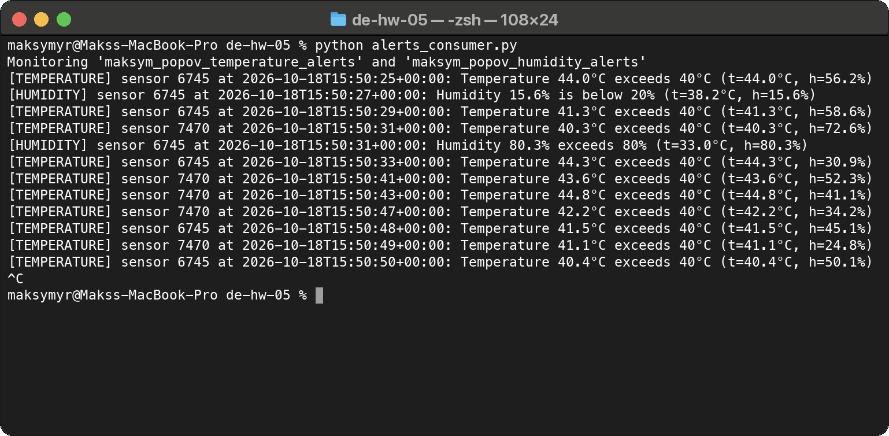

# Apache Kafka. Моніторинг IoT-датчиків

Студент: Максим Попов, CS & AI 2

Домашнє завдання 5 курсу Data Engineering. Датчики в будівлях надсилають
температуру й вологість у Kafka, окремий скрипт відбирає виміри за межами
норми й пише сповіщення в окремі топіки, ще один скрипт читає ці сповіщення.

Потік даних:

1. `sensor_producer.py` (по одному запуску на датчик) пише виміри в `building_sensors`.
2. `alerts_processor.py` читає `building_sensors` і пише сповіщення в `temperature_alerts` та `humidity_alerts`.
3. `alerts_consumer.py` читає обидва топіки сповіщень.

| Файл | Призначення |
|------|-------------|
| [create_topics.py](create_topics.py) | створення трьох топіків |
| [sensor_producer.py](sensor_producer.py) | імітація одного датчика, запис у `building_sensors` |
| [alerts_processor.py](alerts_processor.py) | читання `building_sensors`, фільтрація, запис сповіщень |
| [alerts_consumer.py](alerts_consumer.py) | читання й виведення сповіщень |
| [topic_stats.py](topic_stats.py) | кількість повідомлень у кожному топіку |
| [kafka_common.py](kafka_common.py) | імена топіків, порогові значення, параметри підключення |

## Запуск

```bash
pip install -r requirements.txt
cp configs.example.py configs.py      # вписати параметри підключення
python create_topics.py
python alerts_consumer.py             # термінал 1
python alerts_processor.py            # термінал 2
python sensor_producer.py             # термінали 3, 4, ... по одному на датчик
```

У `sensor_producer.py` є два необов'язкові параметри: `--count N` задає
кількість вимірів (за замовчуванням датчик працює до Ctrl+C), `--interval S`
задає паузу між вимірами в секундах (за замовчуванням 2).

`configs.py` з логіном і паролем не входить у репозиторій. Перевірено на
Python 3.11 і `kafka-python` 2.3.2.

## 1. Створення топіків

Кластер спільний для всіх студентів, тому до імен топіків додано префікс
`maksym_popov`:

| Топік | Вміст |
|-------|-------|
| `maksym_popov_building_sensors` | виміри всіх датчиків |
| `maksym_popov_temperature_alerts` | сповіщення про температуру понад 40 °C |
| `maksym_popov_humidity_alerts` | сповіщення про вологість понад 80 % або нижче 20 % |

У кожного топіка 2 партиції й коефіцієнт реплікації 1. Скрипт створює лише
ті топіки, яких ще немає, тому повторний запуск не падає з помилкою. Наприкінці
список топіків виводиться командою з умови:

```python
[print(topic) for topic in admin_client.list_topics() if MY_NAME in topic]
```



## 2. Генерація даних датчиків

Один запуск `sensor_producer.py` імітує один датчик. ID датчика випадкове
число від 1000 до 9999, воно не змінюється до кінця запуску. Виміри
надсилаються з паузою 2 секунди:

```json
{"sensor_id": 7470, "timestamp": "2026-10-18T15:50:22+00:00",
 "temperature": 34.3, "humidity": 42.3}
```

Температура генерується в діапазоні від 25 до 45, вологість від 15 до 85.

Ключем повідомлення є ID датчика. Повідомлення з однаковим ключем потрапляють
в одну партицію, а всередині партиції Kafka зберігає порядок запису. Тому
виміри кожного датчика обробляються в тому порядку, в якому їх надіслано.
Номер партиції для датчика визначає хеш ключа.

Скрипт чекає підтвердження від брокера (`send(...).get()`) і виводить
партицію та offset кожного запису.

На скриншоті два датчики, запущені одночасно в окремих терміналах. Обидва
ключі, 7470 і 6745, потрапили в партицію 1, тому партиція 0 у цьому запуску
порожня. Offset'и двох датчиків чергуються: у 7470 парні, у 6745 непарні,
тобто записи йшли паралельно.



## 3, 4. Фільтрація та відправлення сповіщень

`alerts_processor.py` читає `building_sensors` і перевіряє кожен вимір:

| Умова | Топік сповіщення |
|-------|------------------|
| `temperature > 40` | `temperature_alerts` |
| `humidity > 80` або `humidity < 20` | `humidity_alerts` |

Один вимір може дати обидва сповіщення. У сповіщенні є ID датчика, обидва
показники, час виміру, час формування сповіщення й текст:

```json
{"sensor_id": 6745, "timestamp": "2026-10-18T15:50:27+00:00",
 "temperature": 38.2, "humidity": 15.6,
 "alert_time": "2026-10-18T15:50:27+00:00",
 "message": "Humidity 15.6% is below 20%"}
```

Автокоміт offset'ів вимкнено. Процесор комітить offset виміру тільки після
того, як брокер підтвердив запис сповіщень. Якщо процесор зупиниться між
читанням і відправленням, після перезапуску вимір буде оброблено ще раз і не
загубиться. Це режим доставки at least once.

Для кожного виміру процесор виводить отримані значення й результат перевірки:
`OK` або `ALERT` з топіком, партицією та offset'ом записаного сповіщення.



З 30 вимірів сповіщення отримали 12: 10 за температурою і 2 за вологістю.
Кількість повідомлень у топіках це підтверджує:



## 5. Читання сповіщень

`alerts_consumer.py` підписаний на обидва топіки сповіщень і виводить кожне
сповіщення з позначкою типу.



Отримано всі 12 сповіщень, стільки ж, скільки відправив процесор і скільки
лежить у топіках.
