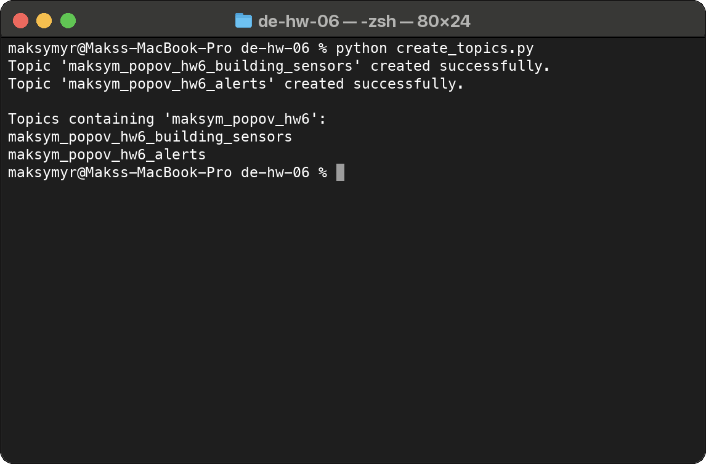
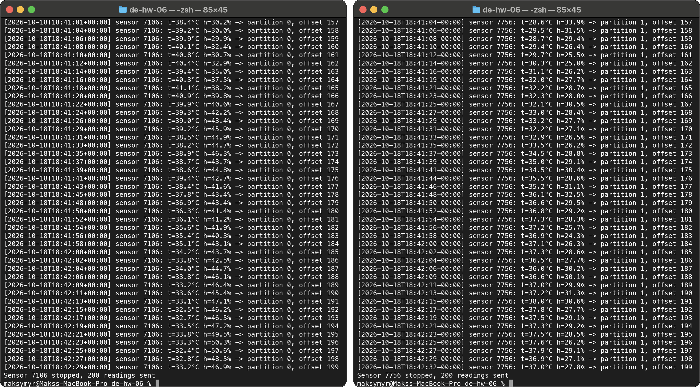
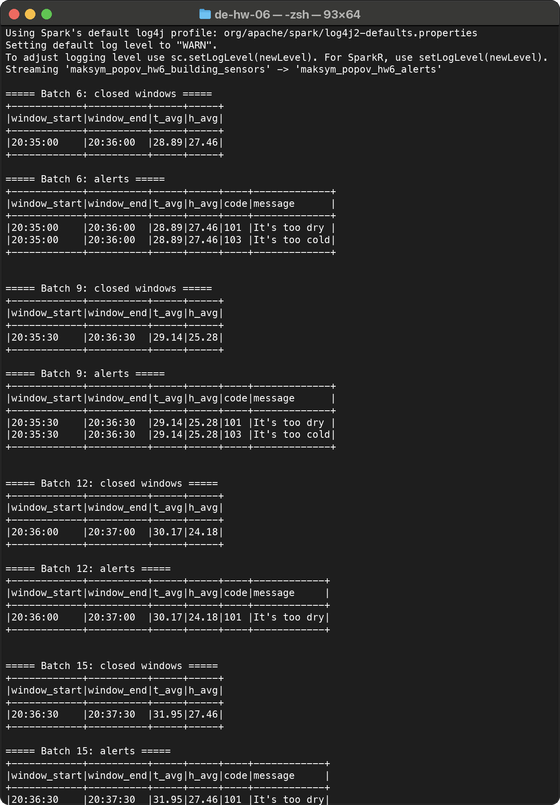
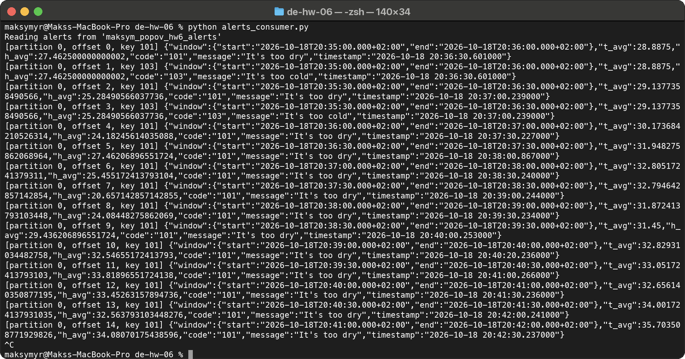

# Домашнє завдання 6. Spark Streaming

Студент: Максим Попов, CS & AI 2

Програма читає дані датчиків з Kafka, рахує середню температуру й вологість у ковзному вікні, перевіряє їх за умовами з `alerts_conditions.csv` і пише алерти в окремий топік.

## Запуск

```bash
pip install -r requirements.txt
cp configs.example.py configs.py   # вписати дані для підключення до Kafka
python create_topics.py
python streaming_alerts.py
python alerts_consumer.py
python sensor_producer.py          # кожен запуск це окремий датчик
```

Останні три скрипти запускаю кожен у своєму терміналі. Для Spark потрібна Java 17+. Коннектор до Kafka Spark завантажує сам.

## 1. Генерація даних

Створюю два топіки: `maksym_popov_hw6_building_sensors` для даних датчиків і `maksym_popov_hw6_alerts` для алертів.



`sensor_producer.py` взяв з минулого ДЗ. Один запуск це один датчик з випадковим ID, з паузою 2 секунди він відправляє:

```json
{"id": 7106, "temperature": 30.6, "humidity": 19.4, "timestamp": "2026-10-18T18:35:35+00:00"}
```

Діапазони ті самі: температура 25-45, вологість 15-85. Поле `sensor_id` перейменував на `id`, як в умові, і зробив так, що значення не випадкові кожного разу, а змінюються поступово (на 1 градус і 3 % максимум за крок). З повністю випадковими значеннями середнє за хвилину завжди виходило десь 35 градусів і 50 %, і алерти не спрацьовували.

Два датчики, запущені одночасно (`--count 200`):



## 2. Середні значення

Вікно 1 хвилина з кроком 30 секунд, watermark 10 секунд:

```python
averages_df = (
    readings_df
    .withWatermark("event_time", "10 seconds")
    .groupBy(F.window("event_time", "1 minute", "30 seconds"))
    .agg(F.avg("temperature").alias("t_avg"), F.avg("humidity").alias("h_avg"))
)
```

Режим `append`, тому вікно виводиться один раз, коли воно закрилось.

## 3, 4. Умови та алерти

Умови читаю з `alerts_conditions.csv`. -999 означає, що межа не використовується. Середні з'єдную з умовами через cross join і фільтрую:

```python
alerts_df = (
    averages_df.crossJoin(conditions_df)
    .where(
        within(F.col("h_avg"), F.col("humidity_min"), F.col("humidity_max"))
        & within(F.col("t_avg"), F.col("temperature_min"), F.col("temperature_max"))
    )
)
```

Spark виводить у консоль середні для кожного закритого вікна і алерти для нього. Тут видно, що у вікнах 20:35:00 і 20:35:30 спрацювали два алерти (101 і 103), а у вікні 20:36:00 температура 30.17, тому тільки 101.



## 5. Запис у Kafka

Алерти пишуться в `maksym_popov_hw6_alerts` у форматі з умови, ключ це код алерту:

```json
{"window": {"start": "2026-10-18T20:35:00.000+02:00", "end": "2026-10-18T20:36:00.000+02:00"},
 "t_avg": 28.8875, "h_avg": 27.462500000000002,
 "code": "101", "message": "It's too dry", "timestamp": "2026-10-18 20:36:30.601000"}
```

Перевірка через `alerts_consumer.py`, у топіку 15 алертів:


