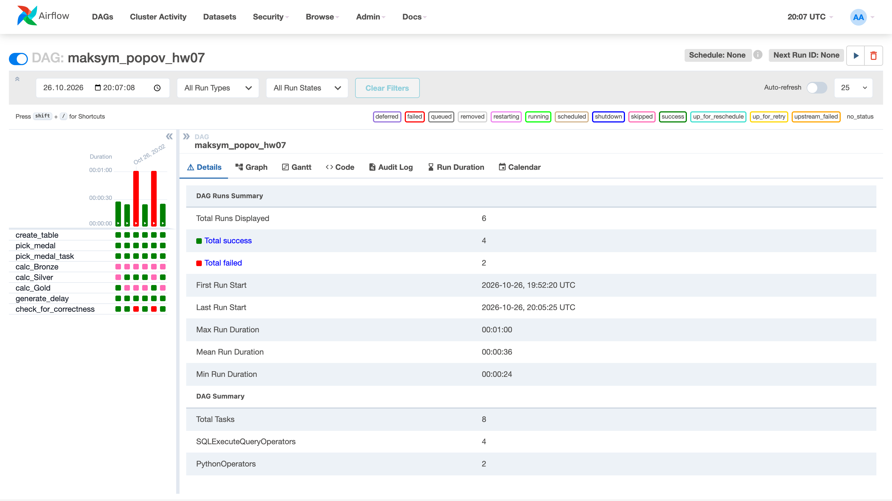
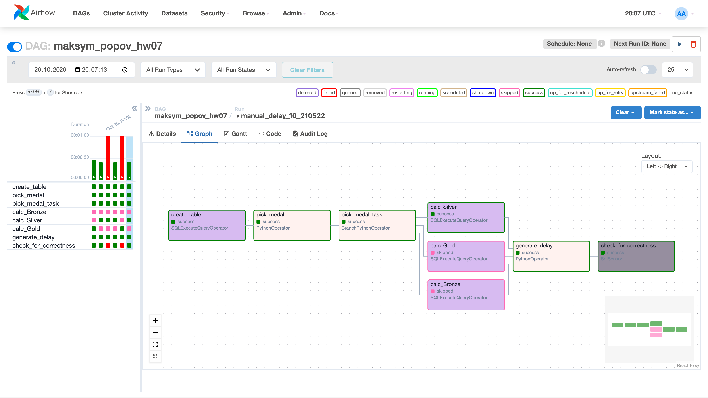
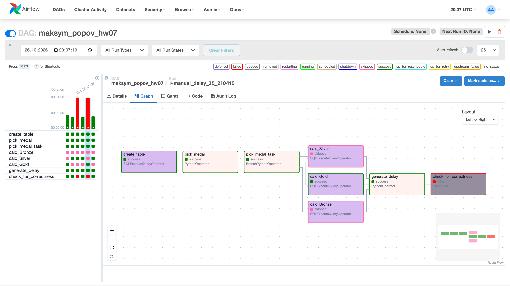
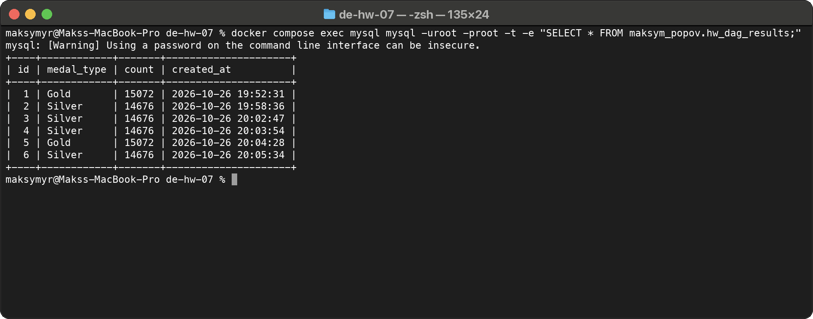

# Домашнє завдання 7. Apache Airflow

Студент: Максим Попов, CS & AI 2

За погодженням з ментором DAG запускав локально: MySQL і Airflow 2.9.3 у Docker.

## Запуск

```bash
mkdir -p data
curl -o data/athlete_event_results.csv https://ftp.goit.study/neoversity/athlete_event_results.csv
docker compose up -d
```

MySQL при першому старті створює `olympic_dataset.athlete_event_results` і заливає туди CSV (`mysql/init/01_olympic_dataset.sql`). Airflow працює в режимі `standalone`, папка `dags/` змонтована в контейнер, підключення до MySQL задане змінною `AIRFLOW_CONN_GOIT_MYSQL_DB`. UI на http://localhost:8080, логін `admin` / `admin`.

## DAG

Код у [dags/maksym_popov_hw07_dag.py](dags/maksym_popov_hw07_dag.py). Завдання:

1. `create_table` створює `maksym_popov.hw_dag_results` (id, medal_type, count, created_at), якщо її ще немає.
2. `pick_medal` випадково обирає Bronze, Silver або Gold.
3. `pick_medal_task` (BranchPythonOperator) запускає одне з трьох завдань залежно від медалі.
4. `calc_Bronze`, `calc_Silver`, `calc_Gold` рахують записи з цією медаллю в `olympic_dataset.athlete_event_results` і пишуть результат у таблицю разом з типом медалі й часом.
5. `generate_delay` робить `time.sleep`, якщо одне з трьох завдань завершилось успішно (`trigger_rule=ONE_SUCCESS`).
6. `check_for_correctness` (SqlSensor) перевіряє, що найновіший запис не старший за 30 секунд.

Для SQL використовую `SQLExecuteQueryOperator` замість застарілого `MySqlOperator`. Затримку передаю параметром `delay_seconds` (за замовчуванням 10), щоб для перевірки сенсора запускати DAG через "Trigger DAG w/ config" з `{"delay_seconds": 35}`.

## Результати

Запустив DAG 6 разів: 4 рази із затримкою 10 секунд і 2 рази з 35. Запуски з 35 секундами впали на сенсорі, решта успішні.



Успішний запуск. Виконалась тільки гілка з обраною медаллю, дві інші пропущені:



Запуск із затримкою 35 секунд. Запис у таблицю відбувся, але сенсор упав, бо запис уже старший за 30 секунд:



Таблиця результатів, по одному рядку на кожен запуск:


