# Аналіз даних про інфекційні захворювання

Фінальний проєкт. Завантаження датасету `infectious_cases`, нормалізація до
3НФ, аналітичні запити та власна функція.

```
rdb_final_project/
├── infectious_cases.csv          # вихідні дані
├── sql/
│   ├── p1_create_schema.sql      # пункт 1 — схема та імпорт
│   ├── p2_normalize.sql          # пункт 2 — нормалізація до 3НФ
│   ├── p3_rabies_stats.sql       # пункт 3 — статистика Number_rabies
│   ├── p4_year_diff.sql          # пункт 4 — різниця в роках
│   └── p5_function.sql           # пункт 5 — власна функція
└── screenshots/
    ├── p1/
    │   ├── p1_create_db.png                # створення схеми pandemic
    │   ├── p1_import_data.png              # імпорт infectious_cases.csv
    │   └── p1_schema_import_and_count.png  # кількість завантажених записів
    ├── p2/
    │   ├── p2_create_entities.png          # CREATE TABLE entities
    │   ├── p2_create_cases.png             # CREATE TABLE cases
    │   ├── p2_insert_entities.png          # наповнення entities
    │   ├── p2_insert_cases.png             # наповнення cases
    │   └── p2_normalize_check.png          # перевірка цілісності
    ├── p3_rabies_stats.png                 # статистика Number_rabies
    ├── p4_year_diff.png                    # різниця в роках
    └── p5/
        ├── p5_function_created.png         # створення функції
        └── p5_function_result.png          # застосування функції
```

---

## Пункт 1. Схема pandemic

```sql
CREATE SCHEMA `pandemic`;

USE `pandemic`;
```

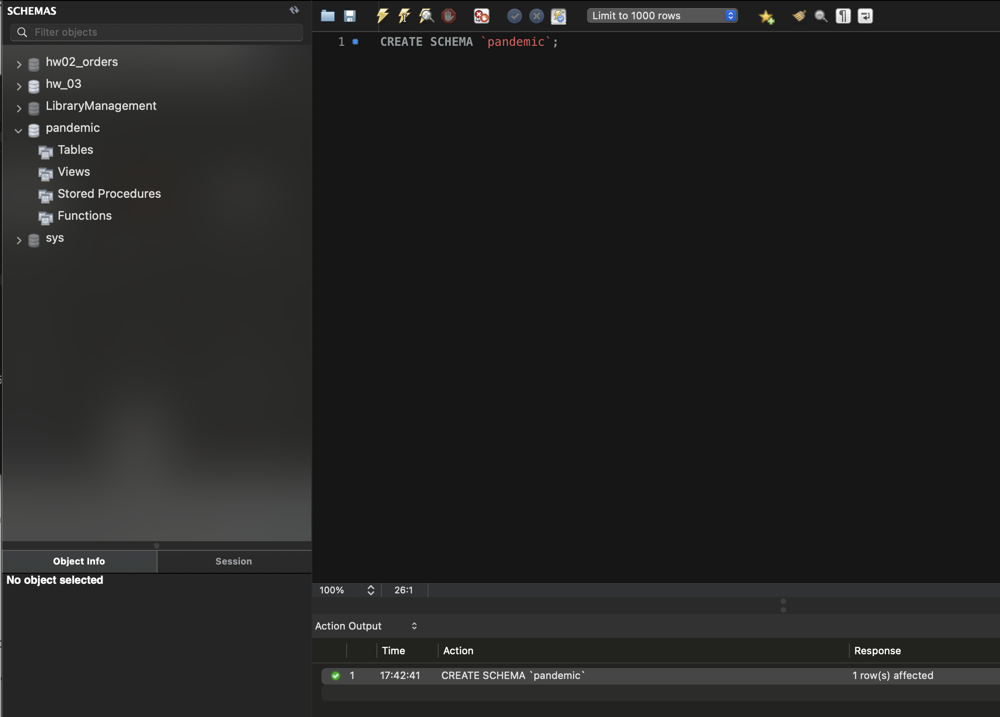

Дані з [infectious_cases.csv](infectious_cases.csv) імпортовано в таблицю
`infectious_cases` через Table Data Import Wizard.

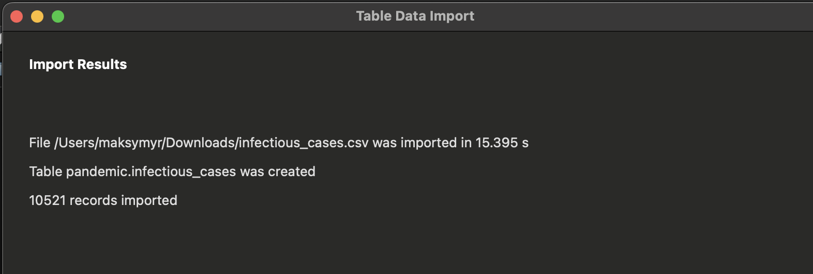

Файл містить 12 атрибутів: `Entity`, `Code`, `Year` і дев'ять показників
захворюваності — від `Number_yaws` до `Number_cholera_cases`.

```sql
SELECT COUNT(*) AS imported_rows FROM `infectious_cases`;
```

**Завантажено 10521 запис.**

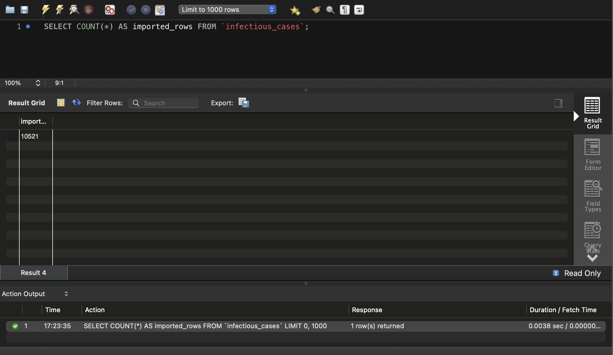

---

## Пункт 2. Нормалізація до 3НФ

### Що саме порушує 3НФ

Пара `Entity` + `Code` повторюється в кожному рядку: 10521 запис описує лише
245 унікальних сутностей. При цьому `Code` залежить не від ключа рядка, а від
`Entity` — це транзитивна залежність, тобто порушення третьої нормальної форми.

Перевірка підтвердила, що залежність `Entity → Code` виконується без винятків:
245 унікальних значень `Entity` дають рівно 245 унікальних пар `Entity + Code`.

### Результат — дві таблиці

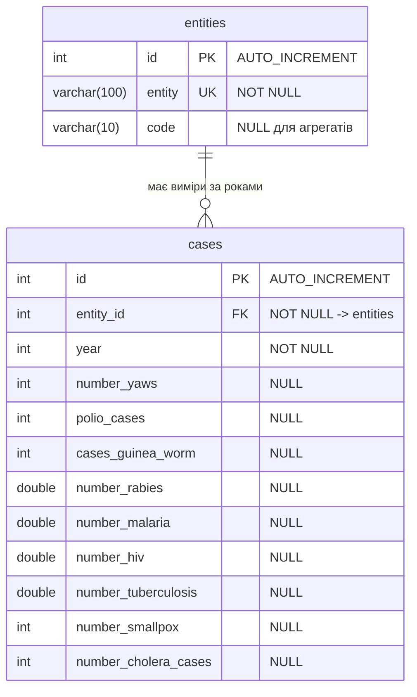

| Таблиця | Призначення | Рядків |
|---------|-------------|-------:|
| `entities` | довідник країн і регіонів: назва та код | 245 |
| `cases` | показники захворюваності по роках | 10521 |

`code` допускає `NULL`: у датасеті 1128 рядків описують не країни, а агрегати
на кшталт `Africa`, `G20` чи `World`, і коду вони не мають. Порожній рядок
замінено на `NULL`, бо відсутність коду — це саме відсутність значення.

Створення таблиць:

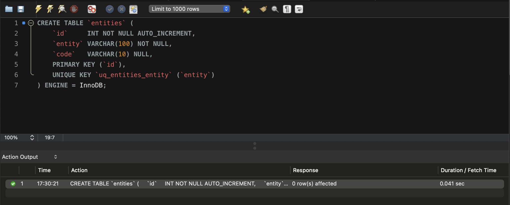

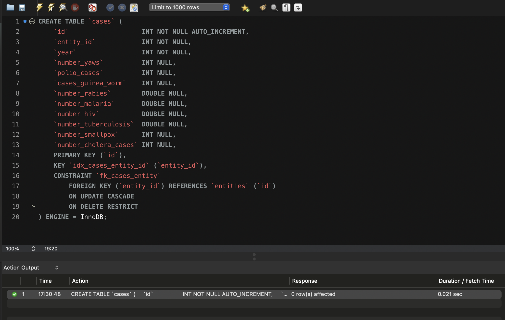

Наповнення даними з `infectious_cases`:

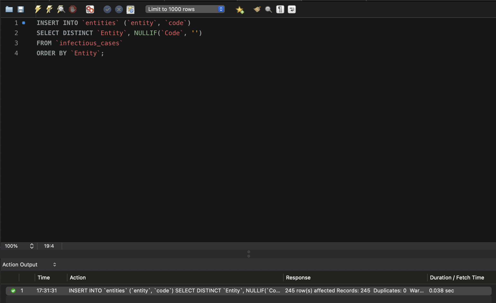

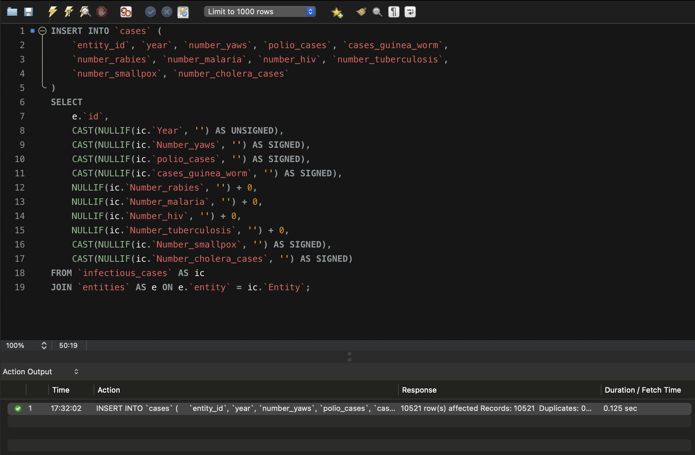

Скрипт завершується перевіркою, що нормалізація нічого не втратила:

```
rows_source  rows_normalized  entities_count
10521        10521            245
```

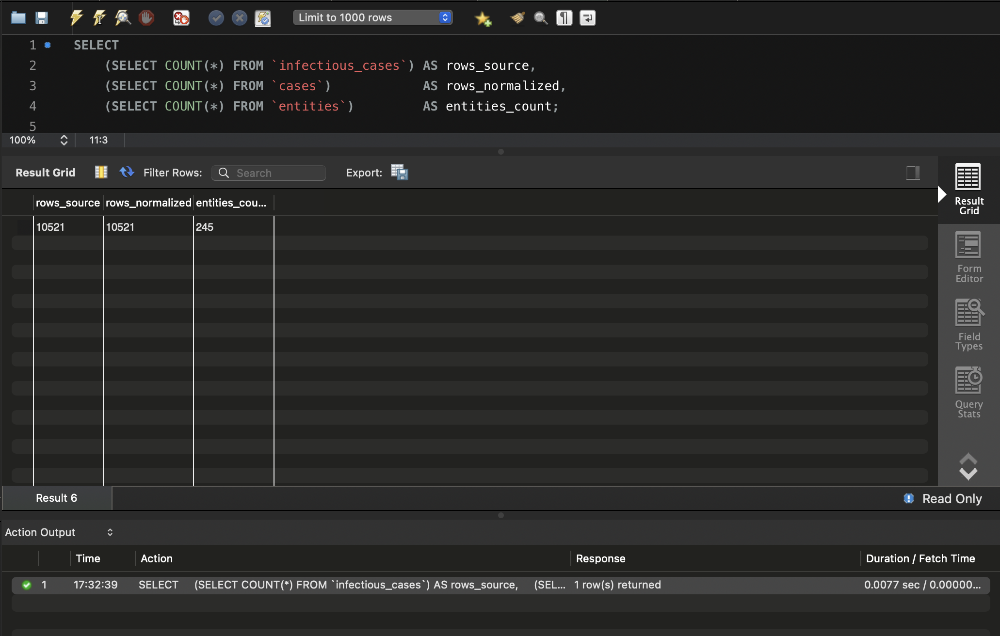

### Приведення типів

Майстер імпорту зберігає відсутні значення як порожній рядок `''` незалежно
від типу колонки, тому при перенесенні даних кожне числове поле обгорнуто в
`NULLIF(..., '')`. Без цього `''` перетворилося б на `0` і зіпсувало б
подальші агрегати: середнє рахувалося б по нулях замість того, щоб
пропускати відсутні виміри.

---

## Пункт 3. Статистика Number_rabies

```sql
SELECT
    e.id     AS entity_id,
    e.entity AS entity,
    e.code   AS code,
    AVG(c.number_rabies) AS avg_rabies,
    MIN(c.number_rabies) AS min_rabies,
    MAX(c.number_rabies) AS max_rabies,
    SUM(c.number_rabies) AS sum_rabies
FROM cases AS c
JOIN entities AS e ON e.id = c.entity_id
WHERE c.number_rabies IS NOT NULL
GROUP BY e.id, e.entity, e.code
ORDER BY avg_rabies DESC
LIMIT 10;
```

Значення `Number_rabies` заповнене в 6780 рядках із 10521, і належать вони
226 сутностям із 245.

Фільтр `IS NOT NULL` тут не зайвий, хоча агрегатні функції й так ігнорують
`NULL`. Без нього у вибірку потрапили б 19 сутностей, у яких немає жодного
виміру сказу: їхній `AVG` дорівнював би `NULL`, і при сортуванні за спаданням
вони просто засмічували б результат.

**Результат:**

| entity_id | entity | code | avg_rabies | min_rabies | max_rabies | sum_rabies |
|----------:|--------|------|-----------:|-----------:|-----------:|-----------:|
| 241 | World | OWID_WRL | 20192.37 | 14075.51 | 24744.66 | 605771.11 |
| 121 | Lower Middle Income (WB) | — | 15193.96 | 10202.53 | 19182.80 | 455818.78 |
| 202 | South Asia (WB) | — | 11729.89 | 7271.28 | 15361.88 | 351896.66 |
| 206 | South-East Asia Region (WHO) | — | 11424.33 | 6806.01 | 15641.96 | 342729.81 |
| 77 | G20 | — | 10189.05 | 6339.08 | 13164.88 | 305671.38 |
| 97 | India | IND | 8599.17 | 5425.87 | 11121.14 | 257975.20 |
| 209 | Sub-Saharan Africa (WB) | — | 4748.27 | 4356.82 | 5017.98 | 142448.04 |
| 3 | African Region (WHO) | — | 4649.70 | 4283.07 | 4917.78 | 139491.07 |
| 120 | Low Income (WB) | — | 3568.11 | 3014.62 | 3873.53 | 107043.16 |
| 58 | East Asia & Pacific (WB) | — | 3427.46 | 2009.94 | 4591.01 | 102823.83 |

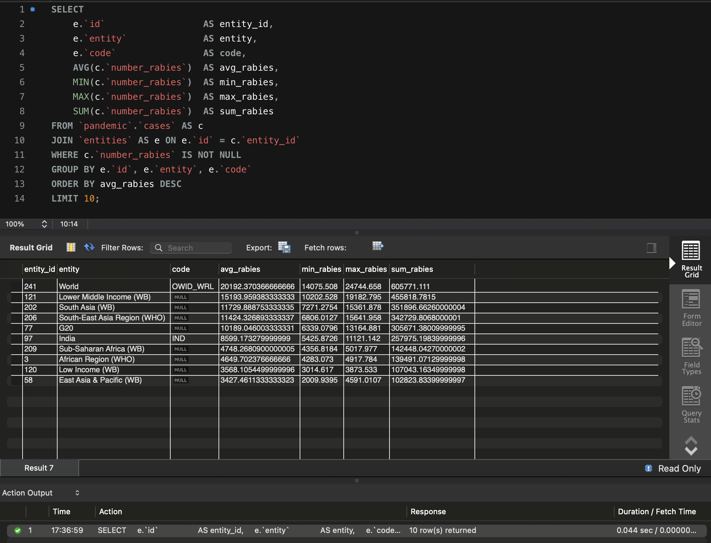

Перші рядки посідають не країни, а агрегати — `World`, групи Світового банку
та регіони ВООЗ. Це очікувано: у датасеті вони лежать поруч зі звичайними
країнами, і їхні значення за визначенням є сумами по багатьох країнах. Перша
справжня країна в рейтингу — Індія на шостому місці.

---

## Пункт 4. Різниця в роках

```sql
SELECT
    c.id,
    c.year,
    MAKEDATE(c.year, 1)                                 AS year_start_date,
    CURDATE()                                           AS today,
    TIMESTAMPDIFF(YEAR, MAKEDATE(c.year, 1), CURDATE()) AS years_diff
FROM cases AS c
ORDER BY c.id;
```

`MAKEDATE(year, 1)` будує дату за номером року й порядковим номером дня в
році, тобто повертає саме 1 січня: `1996` перетворюється на `1996-01-01`.

`TIMESTAMPDIFF(YEAR, ...)` рахує кількість повних років між двома датами.
`DATEDIFF` тут не підійшов би — він повертає різницю в днях.

Результат — 10521 рядок, по одному на кожен запис таблиці `cases`.

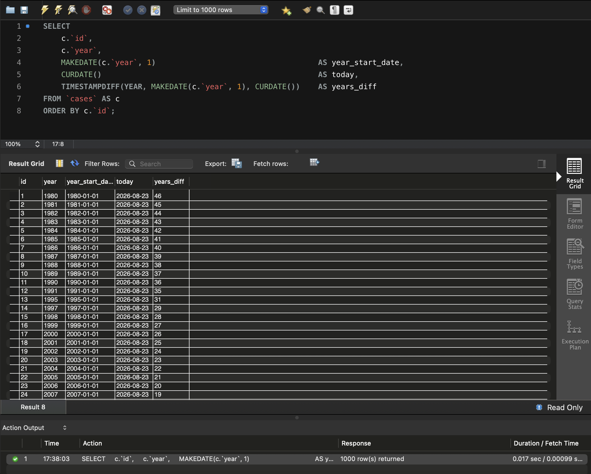

---

## Пункт 5. Власна функція

```sql
DROP FUNCTION IF EXISTS `years_since_year`;

DELIMITER $$

CREATE FUNCTION `years_since_year`(p_year INT)
RETURNS INT
NOT DETERMINISTIC
NO SQL
BEGIN
    IF p_year IS NULL THEN
        RETURN NULL;
    END IF;
    RETURN TIMESTAMPDIFF(YEAR, MAKEDATE(p_year, 1), CURDATE());
END$$

DELIMITER ;
```

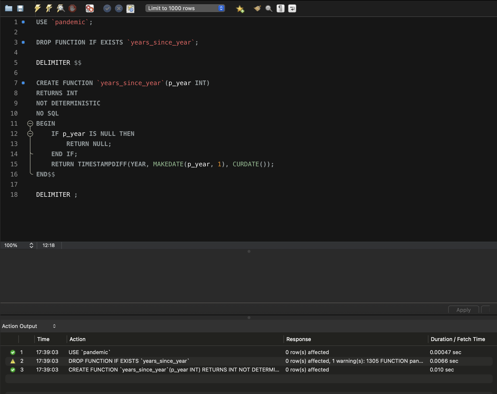

Функція приймає рік, будує з нього перше січня й повертає різницю в роках із
поточною датою — те саме, що запит із пункту 4, але одним викликом.

Застосування до даних:

```sql
SELECT c.id, c.year, years_since_year(c.year) AS years_diff
FROM cases AS c
ORDER BY c.id;
```

Результат функції збігається з результатом вбудованих функцій із пункту 4 на
всіх 10521 рядку — розбіжностей немає.

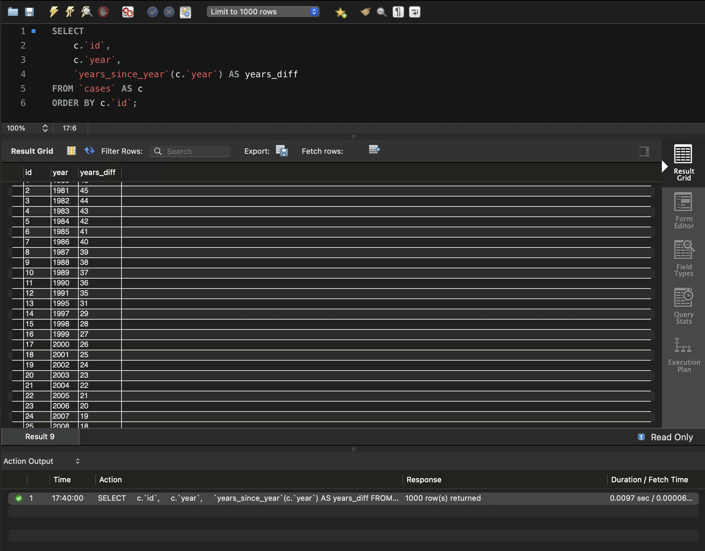

### Про характеристики функції

Функція оголошена як `NOT DETERMINISTIC`, а не `DETERMINISTIC`, і це принципово:
вона викликає `CURDATE()`, тож на тих самих аргументах поверне різні значення
в різні дні. Позначити її детермінованою було б неправдою і могло б призвести
до хибних результатів при кешуванні та реплікації.

При цьому `NO SQL` обов'язковий. Коли ввімкнено бінарне логування, MySQL
відхиляє створення функції, якщо в оголошенні немає жодної з характеристик
`DETERMINISTIC`, `NO SQL` або `READS SQL DATA` — помилка 1418. Оскільки перша
характеристика тут неприпустима за змістом, а до таблиць функція не
звертається, коректний вибір — саме `NO SQL`.

---

## Відповідність критеріям прийняття

| Критерій | Де виконано |
|----------|-------------|
| Створено схему в базі даних, імпортовано дані | [sql/p1_create_schema.sql](sql/p1_create_schema.sql), 10521 запис |
| Таблицю нормалізовано | [sql/p2_normalize.sql](sql/p2_normalize.sql) — `entities` (245) і `cases` (10521) |
| Середнє, мінімальне, максимальне значення та сума `Number_rabies` із сортуванням і обмеженням | [sql/p3_rabies_stats.sql](sql/p3_rabies_stats.sql) |
| Колонка різниці в роках вбудованими функціями | [sql/p4_year_diff.sql](sql/p4_year_diff.sql) |
| Функція розрахунку різниці в роках | [sql/p5_function.sql](sql/p5_function.sql) |
