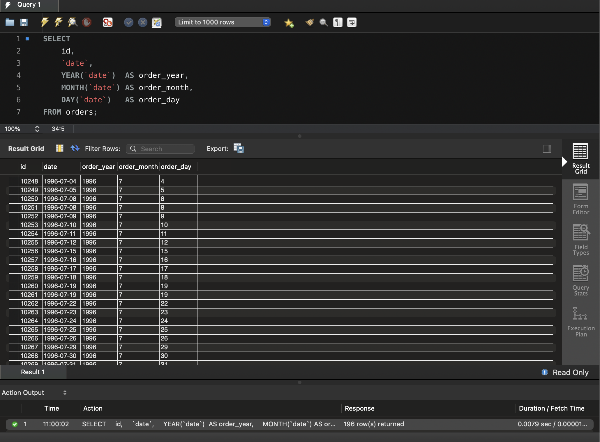
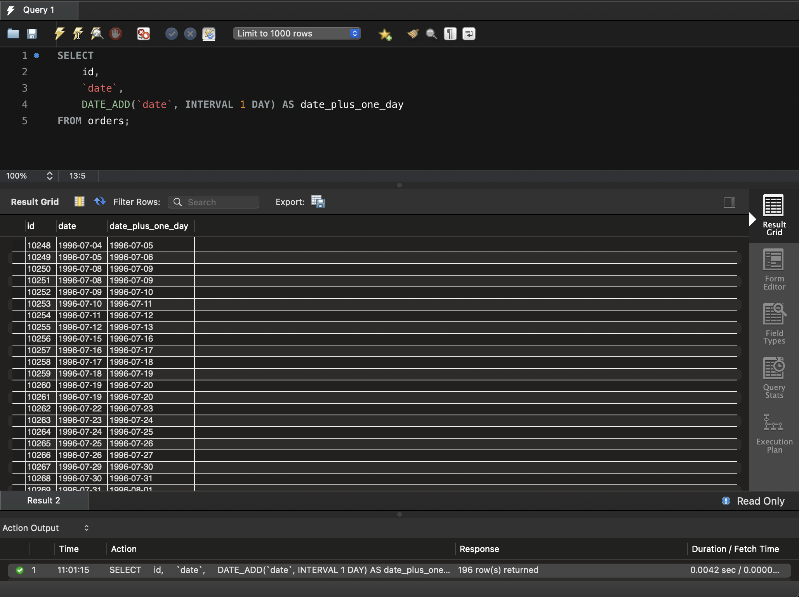
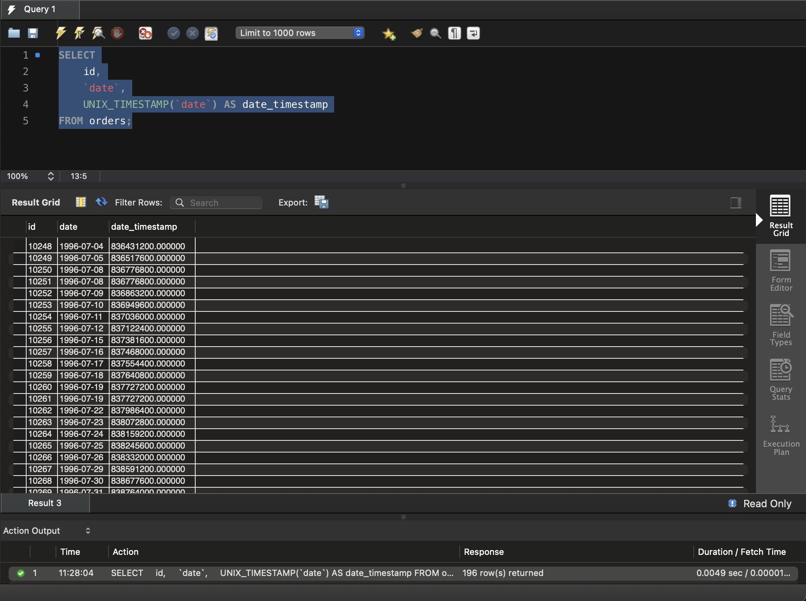
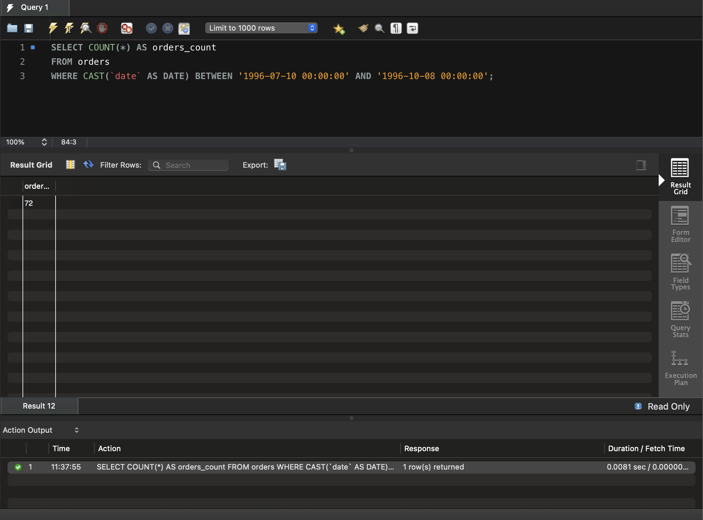
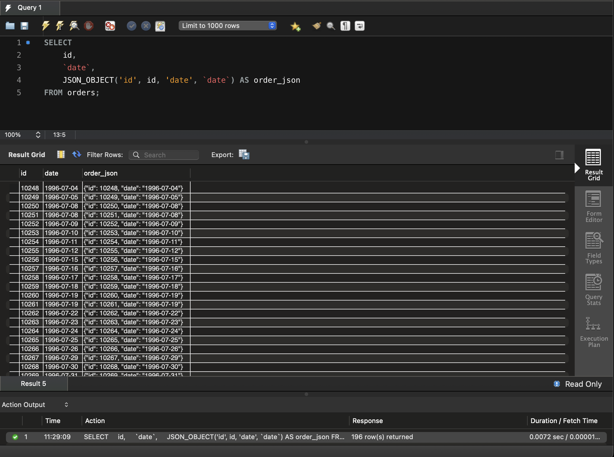

# Додаткові вбудовані SQL-функції. Робота з часом

Домашнє завдання 7. Запити до таблиці `orders` схеми `hw_03` — датасету,
завантаженого в темі 3. Таблиця містить 196 рядків: запити 1, 2, 3 і 5
повертають їх усі, запит 4 — одне число.

Увесь SQL-код зібрано у файлі [sql/queries.sql](sql/queries.sql).

---

## Завдання 1. Рік, місяць і число окремими стовпчиками

```sql
SELECT
    id,
    `date`,
    YEAR(`date`)  AS order_year,
    MONTH(`date`) AS order_month,
    DAY(`date`)   AS order_day
FROM orders;
```

П'ять атрибутів: `id`, оригінальний `date` і три окремі частини дати.



Функції `YEAR()`, `MONTH()` і `DAY()` повертають цілі числа без ведучих
нулів — липень це `7`, а не `07`. Той самий результат можна отримати через
``EXTRACT(YEAR FROM `date`)``; форма з окремими функціями коротша.

---

## Завдання 2. Додавання одного дня

```sql
SELECT
    id,
    `date`,
    DATE_ADD(`date`, INTERVAL 1 DAY) AS date_plus_one_day
FROM orders;
```

`DATE_ADD` коректно обробляє переходи через межі місяця й року: 31 липня
перетворюється на 1 серпня, а 31 грудня — на 1 січня наступного року.
Ручне додавання одиниці до номера дня такого не вміє.

Рівнозначний запис — `` `date` + INTERVAL 1 DAY ``.



---

## Завдання 3. Кількість секунд від початку відліку

```sql
SELECT
    id,
    `date`,
    UNIX_TIMESTAMP(`date`) AS date_timestamp
FROM orders;
```

`UNIX_TIMESTAMP()` повертає кількість секунд, що минули від 1970-01-01
00:00:00 UTC — так званої епохи Unix.

Дві деталі, помітні в результаті.

**Часовий пояс.** Функція враховує пояс сесії: оскільки `date` містить лише
дату без часу, MySQL добудовує до неї опівніч **за поясом сервера**. Тому те
саме `1996-07-04` дає різні числа на різних серверах — на цьому сервері зсув
становить дві години, і результат `836431200` рівно на 7200 секунд менший за
значення `836438400`, яке та сама дата має в UTC. Перевірити поточний пояс
можна запитом `SELECT @@time_zone;`.

**Дробова частина.** Значення виводяться як `836431200.000000`, а не цілим
числом, бо стовпчик `date` зберігається як текст. Для текстового аргумента
`UNIX_TIMESTAMP()` повертає `DECIMAL` із шістьма знаками після коми, для
аргумента типу `DATE` — ціле число. На саме значення це не впливає.



---

## Завдання 4. Кількість замовлень у межах дат

```sql
SELECT COUNT(*) AS orders_count
FROM orders
WHERE CAST(`date` AS DATE) BETWEEN '1996-07-10 00:00:00' AND '1996-10-08 00:00:00';
```

`BETWEEN` включає обидві межі, тому замовлення, оформлені саме 1996-07-10 і
саме 1996-10-08, мають потрапити в підрахунок.

Приведення ``CAST(`date` AS DATE)`` тут не косметичне, а обов'язкове.
Стовпчик `date` зберігається як текст, а не як дата. Якщо порівнювати його з
рядковими межами напряму, MySQL зіставляє **рядки посимвольно**, а не дати.
І тоді значення `'1996-07-10'` виявляється **меншим** за нижню межу
`'1996-07-10 00:00:00'`: воно коротше й є її префіксом. Замовлення за 10 липня
мовчки випадають з підрахунку — запит виконується без помилки, але повертає
занижене число.

Перевірка на контрольному наборі з датами 07-09, 07-10, 08-15, 10-08, 10-09:

| Варіант | Результат |
|---------|-----------|
| текстовий стовпчик, межі з часом | 2 — рядок за 10 липня загублено |
| текстовий стовпчик + `CAST` | 3 — правильно |

Верхня межа не страждає: `'1996-10-08'` менше за `'1996-10-08 00:00:00'`,
тобто умові `<=` задовольняє. Втрачається саме нижня.

**Результат: 72 замовлення.** Без приведення запит повертав би 71 — губилося
єдине замовлення, оформлене саме 1996-07-10.



---

## Завдання 5. JSON-об'єкт для кожного рядка

```sql
SELECT
    id,
    `date`,
    JSON_OBJECT('id', id, 'date', `date`) AS order_json
FROM orders;
```

`JSON_OBJECT()` приймає аргументи парами «ключ, значення» і збирає з них
об'єкт. Результат має тип `JSON`, а не рядок, тому до нього можна далі
застосовувати функції на кшталт `JSON_EXTRACT()`.

Приклад значення:

```json
{"id": 10248, "date": "1996-07-04"}
```

Дата серіалізується в рядок у форматі ISO. Зібрати такий самий текст
конкатенацією було б помилкою: `JSON_OBJECT()` сам екранує спецсимволи й
гарантує коректний синтаксис.


